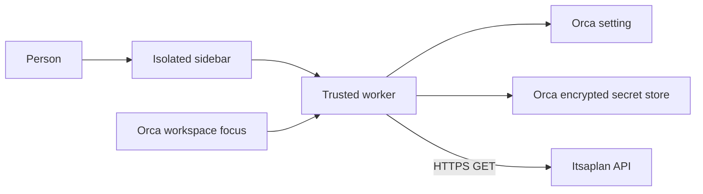
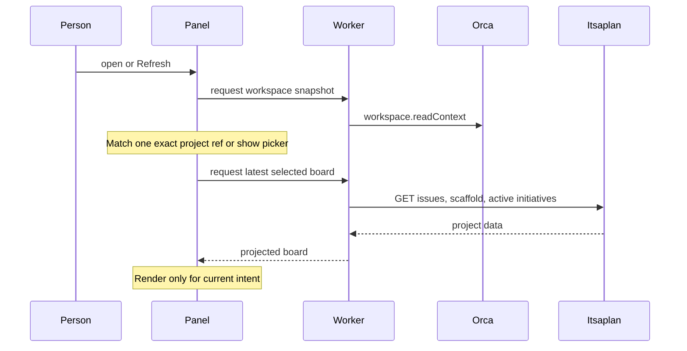

# Design

## Triage

TIER: FULL

T1: New sidebar and worker. T2: URL, credential, and mapping persistence. T3: Async focus, selection and requests. T4: Orca bridge and Itsaplan REST. T5: Issue collections. T6: HTTPS credentials and project data.

## Context

This repository starts with a license and no plugin. Orca’s [v2 manifest schema](https://github.com/stablyai/orca/blob/v1.4.273/docs/schemas/plugins/orca-plugin.v2.schema.json) defines `trusted-worker`, panels and capabilities but no network capability. The [1.4.273 authoring guide](https://github.com/stablyai/orca/blob/v1.4.273/docs/reference/plugin-authoring.md) distinguishes the Node worker from network-closed frames and documents the same-plugin JSON bridge. It does not document a secret-specific bridge. Orca’s [workspace projection](https://github.com/stablyai/orca/blob/v1.4.273/src/main/plugins/workers/host-api/plugin-workspace-projection.ts#L71-L113) strips raw paths from frame context; worker context and `workspace.list` use the same listed identity. The [worker list contract](https://github.com/stablyai/orca/blob/v1.4.273/src/shared/plugins/workers/plugin-host-api-workspace-methods.ts#L62-L89) exposes nullable or optional `hostId` and `projectId`, name and path, but no Git remote URL.

Direct host anchors: [worker workspace authority](https://github.com/stablyai/orca/blob/v1.4.273/src/shared/plugins/workers/plugin-host-api-workspace-methods.ts#L230-L240) and [500-row limit](https://github.com/stablyai/orca/blob/v1.4.273/src/shared/plugins/workers/plugin-host-api-workspace-methods.ts#L17); [Settings IPC](https://github.com/stablyai/orca/blob/v1.4.273/src/main/ipc/plugins/plugin-settings-ipc.ts#L16-L22), [panel notification](https://github.com/stablyai/orca/blob/v1.4.273/src/main/plugins/panels/plugin-panel-bridge.ts#L237-L244) and [frame subscription](https://github.com/stablyai/orca/blob/v1.4.273/src/shared/plugins/frames/plugin-panel-shell-facades.ts#L40-L78); [response ceiling](https://github.com/stablyai/orca/blob/v1.4.273/docs/reference/plugin-authoring.md#L249-L257) and [session identity](https://github.com/stablyai/orca/blob/v1.4.273/src/main/plugins/panels/plugin-panel-bridge.ts#L64-L68).

Authenticated preflight on one instance observed `GET /projects` as an array containing `ref`, `teamName`, `name` and feature flags; `GET /projects/{ref}` as `{ project, columns, … }`; `GET /projects/{ref}/initiatives?status=active` as `{ items, total, page, pageSize }`; `GET /projects/{ref}/issues?limit=2` as an array with `parentId` and `columnId`, but no checklist totals. The separate `/columns` endpoint returned 404. Versioned upstream contracts: [projects](https://github.com/croffasia/itsaplan/blob/57f06d1494fcb683799a7b7e27649cb26d1e34b7/apps/api/src/modules/projects/model.ts), [columns](https://github.com/croffasia/itsaplan/blob/57f06d1494fcb683799a7b7e27649cb26d1e34b7/apps/api/src/modules/columns/model.ts), [initiatives](https://github.com/croffasia/itsaplan/blob/57f06d1494fcb683799a7b7e27649cb26d1e34b7/apps/api/src/modules/initiatives/model.ts), and [issues](https://github.com/croffasia/itsaplan/blob/57f06d1494fcb683799a7b7e27649cb26d1e34b7/apps/api/src/modules/issues/model.ts). These are schema-shape observations, not a guarantee for all self-hosted versions.

The normal worktree gate could not start: there was no OpenSpec root or installed stamp and Git’s main branch was checked out elsewhere. Under the approved workaround, verified that the clean dispatch HEAD, local main and fetched remote main were identical, checked the feature branch did not exist, and created it from main before creating change artifacts. Specwright v0.40.2 was bootstrapped only in this worktree.

## Decisions

### D1: One read-only worker, isolated HTML panel

The HTML panel calls a trusted worker for project lists, selected boards, credential changes and a workspace snapshot. Untrusted strings become text nodes; the worker returns only projected rows with bounded display text. Declare `settings:own`, `secrets:own` and `workspace:read`; no write access to workspaces or terminals. The panel subscribes only to URL setting changes for invalidating credentials and boards, not to workspace or focus events. No ambient credential lookup in shipped code.

### D2: Paired URL and key

The panel reads the non-secret URL setting, displays the exact normalized base beside the password field, and attaches that expected base to the one-way key submission. On a URL setting change it invalidates the draft immediately. The worker rejects stale submissions instead of substituting the latest setting. One encrypted record contains the base and key, so no halfway pairing is usable: if save fails, retry from the displayed base; an older record is usable only for its own base. Each operation uses one validated base snapshot for credential lookup and URL construction. Require HTTPS, no user info/query/fragment, normal TLS, and exact-base pairing including reverse-proxy prefixes. Tracker refs must be one validated path segment. Only the worker injects `x-api-key`; no redirects, sensitive response echoes, raw errors or logs. Clear the password field before awaiting its save.

### D3: Bounded project board and transient selection

Fetch `/projects` for accessible projects and label by team and project. Load the selected project’s scaffold, first 100 active initiatives, and up to 200 recent issues. A page whose total exceeds the rows shown, or a plain issue array at the cap, gets a partial-results notice. Initiative progress is server-reported completed/total issue counts. Columns follow board position. Compute direct subtask progress locally: if a parent has two listed children, one in a completed column and one in an open column, show 1/2; an unlisted child contributes neither count. Unknown columns use a separate group; optional initiative failure does not block issues. No extra per-issue reads; the lightweight list has no checklist totals.

Read the lightweight issues before the scaffold and validate the scaffold’s `project.id` against the selected stable id before projecting any issue. A ref reused after deletion during this batch cannot pass that final identity check; a mismatch fails the required board load, never creating an unknown-column group. Read initiatives only after that check, and reject the optional initiative section if any returned `projectId` differs. The scaffold and initiative checks require no additional GET.

On panel open or Refresh, read `workspace.readContext` in the worker. An identifiable workspace returns its display name, not its id or path. Treat a workspace explicitly named with an exact team-qualified tracker project ref as a declaration of its project. Select only one exact catalog match. Ordinary names, duplicate refs and missing or failed context never guess a project. Hand picks are local to the panel and last until a workspace check succeeds; a failed check can reload the hand pick as manual but never reloads a previous automatic board.

### Decision summary

- Own the bridge and markup; use host secrets and settings as provided. Store no project preference.
- Require HTTPS and bind credentials to the configured base; allow private endpoints trusted by the worker’s TLS stack.
- No dependencies: eligible package inventory is empty, so install-hook, code, maintainer, download, audit and OSV reviews are not applicable. Pin pnpm 11.1.1, require 10080-minute release age and block lifecycle scripts; no script exceptions.

## Assumptions

1. Approved Orca 1.4.273 allows outbound fetch from its trusted worker. Verify in the real host, not through an ordinary Node process.
2. The worker can store and reread a secret on this desktop, subject to the OS keyring. Verify by loading projects from a newly started worker with only stored configuration.
3. WSL and SSH may supply a stable identity through the same focus contract. Report available live coverage; do not infer a live result from source.
4. Itsaplan versions that implement the observed lightweight issue, scaffold and initiative schemas are supported. Verify via schema-based deterministic fixtures and an authenticated real Orca run; don't assume `/columns` works.

## Carried constraints

- Tracker operations are GET-only, with one HTTPS base, encrypted URL-bound credentials, no redirects and no credential in replies or logs. Durable home: `itsaplan-sidebar` requirement Read-only HTTPS connection.
- Only the panel loads data; no polling, no per-issue reads, listed-only subtask progress, no native Tasks provider, no worktree creation, and no tracker-specific presets. Durable home: `itsaplan-sidebar` requirement Project board summary.
- Snapshot on open or Refresh only, no focus subscriptions or per-workspace preferences. Durable home: `itsaplan-sidebar` requirement Workspace project snapshot.
- No package dependencies or build products required to install. Durable home: README development and installation instructions.

## Diagrams (FULL)

## State & Ownership (FULL)

| State | Owner | Lifetime |
| --- | --- | --- |
| API base URL | Orca setting | Plugin installation |
| URL-bound key | Orca encrypted secret store | Until replaced or cleared |
| Workspace snapshot and manual selection | Panel | Snapshot until the next check; hand pick until a successful check or teardown |
| Draft key | Password control | Until submission or close |
| Projects, board, UI generations | Panel | Until refresh or close |
| In-flight GETs, latest pending read | Worker request lane | Body deadline, completion or cancellation |

## Failure & Visibility (FULL)

Invalid URL, stale draft, missing key, unavailable keyring and network/HTTP errors are actionable in the sidebar. Failure loading project list, scaffold, or issues clears unverifiable content; optional initiative failure leaves the board and a separate unavailable notice. An oversized required response or excess scaffold columns reports an error rather than drawing a misleading board. Truncated project choices and capped board sections display their limits. Unknown columns are grouped explicitly. No error includes raw remote or host text.

## Resource Bounds (FULL)

Opening or refreshing the panel makes one workspace host call, one project-list GET, and up to three sequential GETs if a project is selected: issues, identity-checked scaffold and enabled initiatives. The worker lane has one active batch and one pending slot. New work may replace its own pending read and abort its own active read; a board cannot displace a project list. Another session may fill an empty slot but cannot displace another session’s work. Only an open sidebar can initiate tracker reads. Cap decoded bodies at 2 MiB before parsing with a deadline through body consumption. Cap projects at 500, issues at 200, initiatives and scaffold columns at 100. Bound display strings below the bridge ceiling. Group and count with one pass, then sort by column and board position when known.

## Flow & State Gaps (FULL)

Only open and Refresh request a workspace snapshot. Start the snapshot and catalog reads together and abort the old board before either resolves. Select a board only after both are ready. A successful workspace check discards any hand pick, even without a matching tracker ref; a failed check uses only the hand pick and labels it manual. Ignore cancelled board replies. URL changes clear the draft, list and board and never trigger a new workspace snapshot.

Successful key save for the current base invalidates prior connection results and starts a fresh list through the same list-before-board path, including recovery from missing-key errors. A save completion superseded by a URL edit or panel disposal cannot refresh the obsolete connection.

## Mechanism Ledger (FULL)

| Mechanism | Failure prevented |
| --- | --- |
| URL-bound encrypted secret and disabled redirects | Credential replay against a changed URL or redirect target |
| Deadline through the body, byte cap, and bounded latest-read lane | Hung UI and unbounded memory or request fan-out |
| GET-only adapter and fixed errors | Unintended mutation and raw response leakage |
| Request generations and host setting subscription | Out-of-order connection and board completion |
| Exact qualified ref and no focus event handling | Cross-team routing ambiguity and event-order races |
| Cap indicator and listed-only progress | Misrepresenting partial results as the complete board |

## Risks / Trade-offs

The spike does not cover list paging beyond the stated board caps, simultaneous instance accounts, tracker setup, credential issuance or full issue details. Key scope and membership remain tracker responsibilities. Pairing a new URL requires re-entering its key.

## ADRs

None: spike constraints belong in the capability spec and user-facing limits.

## Open Questions

None requiring a decision before the implementation. Runtime findings will distinguish observed results from unsupported or unexercised routes.
